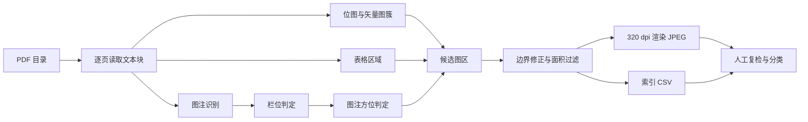

# PDF 图注定位与批量裁图

在本地 PDF 中定位图注，合并图注附近的位图与矢量图，按固定分辨率导出图片，并生成可检索的索引表。

本仓库是一套文献配图整理流程的参考实现。它处理已下载到本地的 PDF，不访问出版商网站，不使用 OCR，不拆分多面板图。输出图片的版权归原论文作者与出版方所有，使用前需逐张核对许可。

## 适用边界

| 项目 | 说明 |
| --- | --- |
| 输入 | 带文本层的本地 PDF |
| 图注格式 | `Fig. 1`、`Figure 1`、`Fig 1.`、`Fig. 1:`、`Fig. 1 (` |
| 输出 | JPEG 图片与 13 列索引 CSV |
| 不处理 | 扫描件、中文图注、补充材料编号、多面板拆分、图内文字识别 |
| 不提供 | PDF 下载、访问控制绕过、许可判定 |

## 流程



## 方法

### 1. 图注识别

图注来自 PDF 文本层。正则匹配 `Fig.` 或 `Figure`、阿拉伯数字和一个分隔符，忽略大小写：

```python
CAPTION_RE = re.compile(
    r"^\s*(?:fig(?:ure)?\.?)\s*(\d+)\s*(?:[.:|]|\s*[\(（])",
    re.IGNORECASE,
)
```

长度不足 30 个字符的文本块会被丢弃，用于排除坐标轴上的 `Fig.` 字样。相同图号且纵坐标相差不足 3 pt 的重复文本块只保留一个。

### 2. 栏位判定

页面按文本块的横向覆盖生成一维数组，采样步长 2 pt。页面宽度 30%–70% 范围内最长的空白区间作为栏间距。空白区间不足 10 pt 时，按单栏页面处理。

图注宽度超过页宽 62% 时，图区允许横跨整页。其余图注按中心点与栏间距的位置归入左栏或右栏。宽度超过页宽 50% 的图形可以属于任意一栏，用于处理跨栏大图。

### 3. 图注方位

图注与图形有以下四种位置关系：

| 方位 | 判定 |
| --- | --- |
| 上方 | 图形底边高于图注顶边，间距不超过 120 pt |
| 下方 | 图形顶边低于图注底边，间距不超过 120 pt |
| 右侧 | 图形与图注纵向重叠超过图注高度的一半，且图形位于图注右侧 |
| 左侧 | 同上，图形位于图注左侧 |

纵向跨过图注的图形簇会在图注上下边界处切开，分别计入上方与下方候选。切开后高度不足 20 pt 的部分会被丢弃。

侧栏图注的判据是图注窄而高：宽度不超过页宽的 35%，高度不小于 80 pt。Science 等期刊将图注排成窄栏，图形位于图注右侧。图形簇可能同时包住图注与图形，此时按图注边缘裁开，只保留图注另一侧的部分。

上方与下方候选按并集面积比较。同一方位的候选以距图注最近的图形簇为锚点，合并横向重叠超过较窄者宽度 30%、纵向间距小于 35 pt 的图形簇。最终图区取并集外接矩形。

### 4. 表格排除

表格区域有三种来源：

1. `Table N` 文本块，加上包含该文本块的大面积填充矩形；
2. `page.find_tables()` 返回的表格框，面积小于页面 50%，且与图注的重叠面积不超过图注面积的 50%；
3. 图注上下边界只取同栏内的表格框。

与表格区域重叠超过自身面积 50% 的图形簇会被剔除，避免图区把表格连同图注一起框入。

### 5. 边界修正

图区向外扩展 3 pt。扩展后执行三项检查：

- 若边界进入侧栏图注，退回图注边缘外 1 pt；
- 若边界切入文本行，退到文本块外 1 pt；
- 与相邻同栏图注之间保留 2 pt 间隔。

面积小于页面 3%、或任一边小于 40 pt 的图区会被丢弃。这两个阈值用于排除页眉标识、页码装饰和单行公式。

### 6. 渲染与命名

| 参数 | 默认值 | 说明 |
| --- | --- | --- |
| `--dpi` | 320 | 渲染分辨率 |
| `--quality` | 92 | JPEG 质量 |
| `--min-area` | 0.03 | 最小图区面积占页面比例 |
| `--max-gap` | 120 | 图注与图形的最大间距，单位 pt |

文件名格式：

```
Fig{图号:02d}_{PDF 文件名}_p{页码:03d}.jpg
```

同一 PDF 同一页出现重复图号时，文件名追加 `_2`、`_3`。PDF 文件名中的 Windows 非法字符替换为下划线。

## 快速开始

```bash
python -m venv .venv
source .venv/bin/activate        # Windows: .venv\Scripts\activate
pip install -r requirements.txt
python extract_figures.py /path/to/pdfs -o out
```

目录会递归查找 `*.pdf`。输出结构：

```
out/
├── _index.csv
├── paper-a/
│   ├── Fig01_paper-a_p003.jpg
│   └── Fig02_paper-a_p004.jpg
└── paper-b/
    └── Fig01_paper-b_p002.jpg
```

索引字段：

| 字段 | 含义 |
| --- | --- |
| `source_pdf` | 源 PDF 文件名 |
| `page` | 页码，从 1 开始 |
| `figure` | 图号 |
| `side` | 图注相对图形的位置：`above`、`below`、`left`、`right` |
| `column` | 图注所在栏：`left`、`right`、`full` |
| `x0_pt`、`y0_pt`、`x1_pt`、`y1_pt` | 图区在 PDF 页面上的坐标，单位 pt |
| `width_px`、`height_px` | 输出图片像素尺寸 |
| `file` | 相对输出目录的图片路径 |
| `caption` | 图注前 300 个字符 |

## 质检

批量导出后执行以下检查：

1. 索引行数与图片文件数一致；
2. 随机抽取 10 张图片，核对图注、面板字母、坐标轴标签和相邻表格是否完整；
3. 保留 3–5 份版式已知的 PDF 作为回归样本，修改脚本后重新导出并对比坐标；
4. 逐张检查图片四边，确认没有正文、图注、页眉或相邻面板残留。

常见版式问题：

| 现象 | 原因 |
| --- | --- |
| 图区包含正文 | 图形簇与正文块相连，或图注方位判断错误 |
| 图区缺少下方面板 | 面板字母位于图框上方，上界取自图形边界 |
| 图区包含表格 | 表格没有填充背景，且 `find_tables()` 未识别 |
| 图区被右边界截断 | 跨栏图的宽度未超过 50% 页宽，按单栏裁剪 |
| 图区包含相邻图注 | 同栏相邻图注的间距小于 2 pt |
| 小图漏检 | 图区面积低于页面 3% |
| 扫描件无输出 | PDF 没有文本层 |
| 补充材料编号错位 | `Figure S1` 与正文图号相同，脚本按阿拉伯数字去重 |

## 已知限制

- 只识别英文 `Fig.` 与 `Figure` 加阿拉伯数字。中文图注、`Supplementary Fig.` 和罗马数字编号不支持。
- 不拆分多面板图。需要单面板时，按 `x0_pt`、`y0_pt`、`x1_pt`、`y1_pt` 在原始 PDF 中二次裁剪。
- 矢量图簇的合并结果依赖 PDF 生成器。同一期刊的不同排版可能得到不同外接矩形。
- 表格识别依赖填充背景、`Table N` 图注和 `find_tables()`。三者都缺失时，表格可能进入图区。
- 侧栏图注的图区可能保留少量空白边。批量导出后仍需逐张复检。
- 旋转页面、跨页大图和双栏不规则分栏不在处理范围内。

## 生产规模参考

一次综述配图整理中，37 份 PDF 经本流程得到 251 张候选图；连同 1 张自绘图，共 252 张进入索引，其中 42 张正选、210 张备选。索引表 252 行、13 列。该结果经过逐张目检和 10 张抽样复核。

## 环境

- Python 3.9+
- PyMuPDF 1.26.5
- Pillow 11.3.0

在 Windows 11 上测试。脚本不依赖 PyWin32、OCR 引擎或外部网络服务。

## 许可

代码以 MIT 许可证发布，见 [LICENSE](LICENSE)。

导出的图片不属于本仓库，其版权与使用条件由原论文的出版协议决定。仓库不包含任何论文 PDF 或导出图片。
